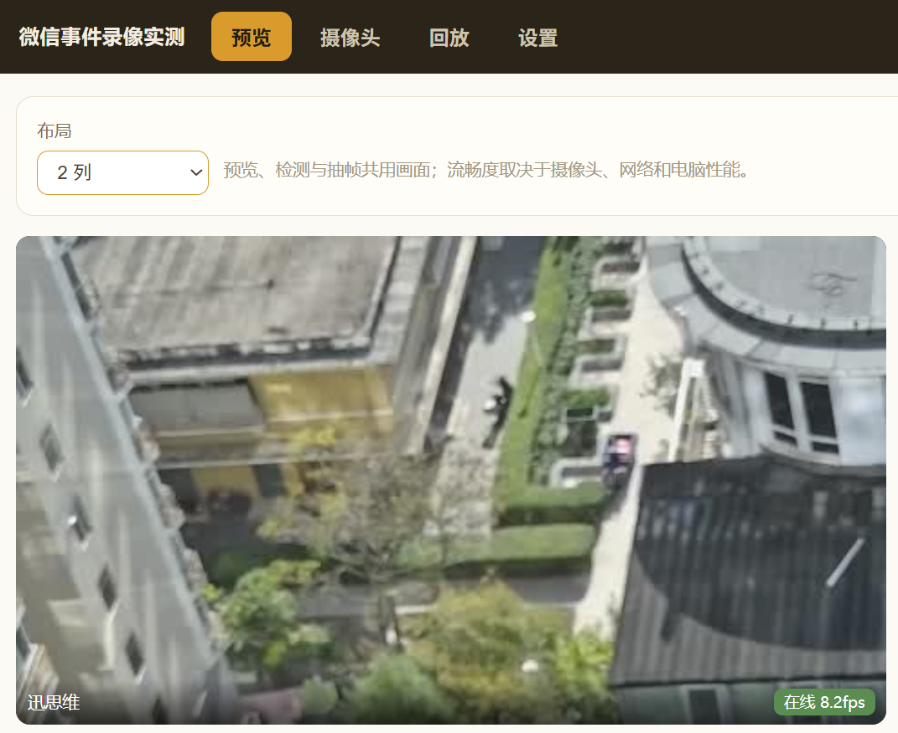
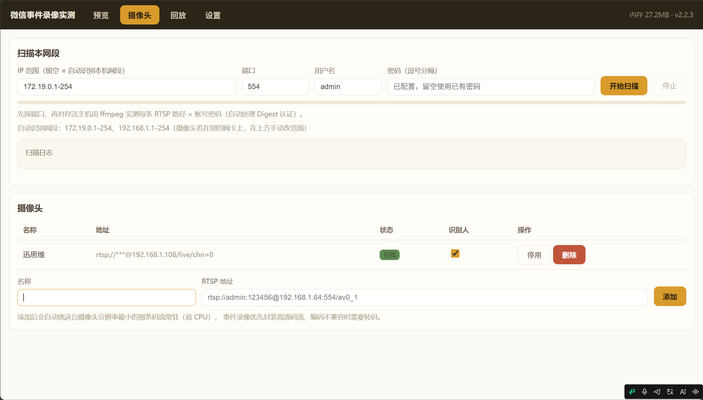
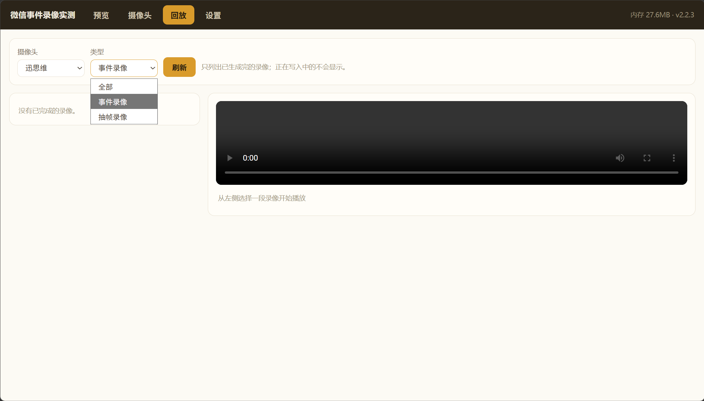
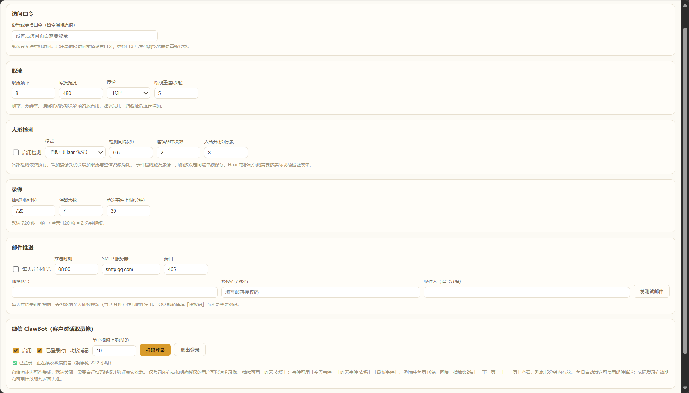
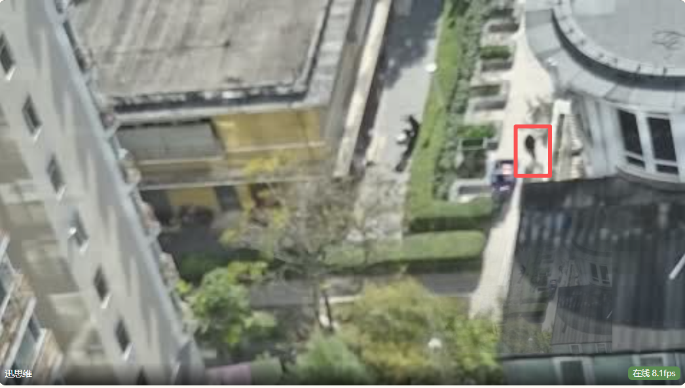

# MiniNVR2 农场轻量录像机

**[下载 Windows 64 位便携版](https://github.com/zhangxutonyace-bit/MiniNVR2-Farm-NVR/releases/download/v2.2.3/MiniNVR2-v2.2.3-windows-x64.zip)** · [查看 Release 与校验文件](https://github.com/zhangxutonyace-bit/MiniNVR2-Farm-NVR/releases/tag/v2.2.3)

完整解压后双击 `MiniNVR2.exe` 即可运行，无需安装 Python。包内附有 `先读我-使用说明.txt`、`微信ClawBot-操作步骤.txt` 和 `微信局域网预览-操作步骤.txt`，可直接打开查看。首次使用方法见 [Windows 下载与运行说明](docs/WINDOWS_DOWNLOAD.md)。

下载后配置微信，请看下方的 [微信 ClawBot 操作步骤](#微信-clawbot-操作步骤)。

v2.3.0 本机测试版已实现跨网段预览：电脑通过 NetBird 建立 HTTPS 连接，手机可在移动网络或其他 Wi-Fi 中查看指定摄像头。手机无需安装 NetBird 或 VPN 客户端；电脑端需自行安装、登录并授权 NetBird。2026-10-19，用户在手机移动网络下打开新链接，确认合成测试画面持续更新；随后补充当前需要复制网址到浏览器，微信聊天内直接点击仍待验收。预览回复现改为单独一条完整网址进行兼容性测试；真实摄像头与其他网络环境尚待分别验证。[远程预览配置与验证范围](docs/REMOTE_PREVIEW.md)。上面的公开 Windows 下载仍为 v2.2.3，仅支持同一 Wi-Fi 预览；v2.3.0 尚未公开发布。

**MiniNVR2｜让旧摄像头和闲置笔记本，重新发挥价值**

农场、养殖场和小型场地的监控需求，往往并不复杂：平时看看现场，有活动时留下录像，需要时能快速回顾。

但实际使用中，常常会遇到几个问题：

- **已有设备，仍要重复投入。** 摄像头还能用，家里也有闲置笔记本，想完善录像和管理功能，却又要考虑购买专用录像机或更换设备。
- **录像很多，查找很累。** 连续录下一整天的视频，真正想了解现场变化时，仍要反复拖动进度条。
- **长时间录像，占用存储空间。** 大量变化不大的画面持续保存，增加了存储和整理负担。
- **能看到画面，却不方便集中管理。** 多路摄像头的预览、录像和回放分散，日常查看不够顺手。
- **人在外面，查看录像不方便。** 想回顾农场情况，还得回到电脑前查找文件。

MiniNVR2 希望用更轻量的方式解决这些问题：**复用现有摄像头和闲置笔记本，搭建一套本地运行的小型智能监控平台。**

通过中文网页界面，你可以集中查看多路摄像头，在检测到活动时保存事件录像；也可以定时抽取画面，将一天的变化汇总成便于回顾的短视频，减少逐段翻找长录像的时间。

**让微信成为随身的农场录像查看入口。**

启用并完成微信 ClawBot 接入后，农场主可以把连接摄像头的笔记本留在家里，保持运行和联网。人在外面时，只需在微信中发出查看请求，可以查询指定摄像头、指定日期的事件列表，选择一段已结束的事件录像回传，也可以接收按日抽帧录像，了解农场的画面变化，无需回到电脑前翻找文件。

从复用旧摄像头、闲置笔记本，到通过熟悉的微信查看录像，MiniNVR2 让小型场地的监控更贴近日常使用习惯。

它支持历史回放、断线重连和录像保留设置，核心预览与录像在本机运行。既让旧设备继续发挥作用，也为小型场地提供一条减少新增硬件投入的监控方案。

**旧设备在家里发挥作用，农场的变化通过微信带在身边。**

设备需支持 RTSP 接入，可接路数和运行效果取决于电脑性能、分辨率及视频编码。微信已实现事件录像与抽帧录像查询；2026-10-18 已使用 Windows v2.2.2 完成真实微信扫码、事件视频上传和手机收件播放测试，素材为6秒合成录像。现场摄像头效果仍需结合实际环境验证。

项目采用 Python、Flask、OpenCV 和 FFmpeg。预览、检测与抽帧复用同一路画面；事件发生时另开录像流，并在编码兼容时优先直接封装，减少重复编码。实际资源占用取决于摄像头数量、分辨率和编码方式。

## 实际使用界面

以下5张为用户提供的实际使用截图，原图完整保留，点击图片即可查看大图。[查看完整截图与说明](docs/SCREENSHOTS.md)。

| 实时预览 | 摄像头管理 |
| :--: | :--: |
| [](docs/screenshots/01-live-preview.png) | [](docs/screenshots/02-camera-management.png) |
| **录像回放界面** | **设置界面** |
| [](docs/screenshots/03-recordings.png) | [](docs/screenshots/04-settings.png) |
| **检测画面示例** | **截图说明** |
| [](docs/screenshots/05-detection-example.png) | 回放图展示筛选和播放器布局，截图时暂无已完成录像。检测红框用于展示画面，检测效果需按现场环境验证。[查看逐图说明](docs/SCREENSHOTS.md)。 |

<details>
<summary>查看本机合成视频回放演示</summary>


上图使用本机生成的合成素材。当前公开发布版本为2.2.3；验证范围见 [验收记录](docs/VALIDATION.md)。

</details>

## 主要功能

- 多路 RTSP 摄像头管理、网页预览、启用与停用。
- 手动添加摄像头，或在用户指定的局域网范围内查找设备；扫描不会自动开始。
- 运动检测、Haar 人形检测与组合模式，按检测事件启停录像。
- 定时保存 JPEG 抽帧，合成为按天回顾的视频。
- 按摄像头、日期和类型查找已完成录像，支持网页播放与进度跳转。
- 断流重连、首帧超时处理、录像保留天数设置。
- 可选 SMTP 邮件和实验性微信 ClawBot 模块，支持事件列表、分页、单段取回和按日抽帧查询，默认均关闭。
- v2.2.3 增加微信指定摄像头的局域网预览链接：同一 Wi-Fi 点击查看单路当前画面，10分钟有效，约每秒刷新一次。[配置步骤](docs/LAN_PREVIEW.md)。

检测采用传统视觉算法，可能漏检或误报；它不等于经过农场现场验证的人员识别，也不提供防入侵或事故报警保证。

## 从源码运行

已验证环境：Windows x64、Python 3.12.10。先安装 Python 3.12 64 位，然后在本目录运行：

```powershell
powershell -NoProfile -ExecutionPolicy Bypass -File .\setup.ps1
```

此脚本只在项目的 `.venv` 中安装 `requirements.txt` 指定版本，不改系统 Python 包。

1. **先看演示**：双击 `Start-Demo.cmd`，打开 `http://127.0.0.1:8801`。演示会生成合成视频，数据写入独立的 `data-demo/`。
2. **正式使用**：双击 `Start-MiniNVR2.cmd`，打开 `http://127.0.0.1:8800`。首次启动摄像头列表为空。
3. 打开“摄像头”页，手动填入自有设备的 RTSP 地址并保存。账号密码只在本机填写，不提交到仓库。
4. 在“预览”确认画面在线，再按现场光线和距离调整“设置”中的检测参数。
5. 在“回放”查看已经完成的录像。正在写入或重封装的录像暂不列出；当日抽帧通常次日合成。
6. 从托盘“退出”或网页设置页“退出程序”关闭程序。关闭浏览器标签页不会停止录像。

默认每 720 秒保存一帧、输出 1 fps；完整运行一天约 120 帧、约 2 分钟，实际长度受运行时长与缺帧影响。抽帧会持续写盘；事件录像单独受检测状态控制。

### 其他启动方式

```powershell
.\.venv\Scripts\python.exe main.py --no-tray --no-browser
.\.venv\Scripts\python.exe main.py --data-dir D:\NVRData --port 8802
```

`--config` 可指定配置文件；`--data-dir` 或环境变量 `NVR_DATA_DIR` 指定日志与默认录像目录。若使用 `--config`，建议同时指定 `--data-dir`。端口冲突会明确失败退出。

## 本机配置与访问

常规配置、日志、录像默认分别在 `data/config.json`、`data/nvr.log`、`data/records/`。本机配置可能保存设备密码和邮箱授权码，应按个人资料保管。仓库排除了这些文件及演示数据、打包结果和测试临时目录。

默认仅监听 `127.0.0.1`。如需在可信局域网使用，先在本机“设置”中保存访问口令，再退出并使用 `--host 0.0.0.0` 重启。API、预览、截图和回放均受口令保护，浏览器登录后使用 HttpOnly、SameSite Cookie。更换口令会使旧会话后续请求失效，已有视频长连接在断开后重新鉴权。

这是本地桌面工具，附带的 HTTP 服务没有 TLS 和公网生产部署配置。不要直接做公网端口映射；远程访问需另行配置受控 VPN 或带 HTTPS 的访问层。

## 可选集成

**邮件**：在本机填写 SMTP 信息并自行测试。TLS 握手失败时程序不会继续发送登录凭据。每日邮件启用后会发送前一天的抽帧录像；请确认收件人和附件大小。

**微信**：源代码包含实验性 iLink 协议适配。默认关闭且不自动登录。只有配置记录的登录用户或 `clawbot.allowed_users` 中明确允许的用户可以请求录像；未知消息只返回帮助。

### 微信 ClawBot 操作步骤

1. **启动程序**

   完整解压下载包，双击 `MiniNVR2.exe`。电脑浏览器会打开管理页面；没有自动打开时，手动访问 `http://127.0.0.1:8800`。

2. **确认已有事件录像**

   在“摄像头”中添加自己的设备，确认预览正常，并在“回放”中确认已有至少一段录制结束的事件录像。微信只能取回已经保存的录像。

3. **启用微信功能**

   打开“设置”，找到“微信 ClawBot”，勾选“启用”和“已登录时自动接消息”，再点击“保存设置”。

4. **用自己的微信扫码**

   点击“扫码登录”，用手机微信扫描二维码，并在手机上确认。电脑页面显示“已登录，正在接收微信消息”后，即可使用。

5. **先试着接收一段录像**

   在手机的“微信 ClawBot”聊天中，单独发送 **最新事件**。程序会回传今天最近一段已完成的事件录像，收到后点开播放。

6. **查看列表并选择录像**

   先发送 **今天事件**，收到列表后，再单独发送 **播放第1条**。还可以发送 **昨天事件**、**下一页**、**上一页**。

每条消息只发送一个指令，序号使用数字，例如“播放第1条”，不要写成“今天事件，播放第一条”。列表15分钟内有效，过期后重新查询。

使用时，电脑需保持开机、联网，程序持续运行且不进入休眠。微信登录过期后，回到电脑页面重新扫码即可。

也可用 `最新事件 农场`、`昨天事件 农场`、`事件 2026-10-18 1号` 按摄像头、日期筛选；“农场”应替换为自己的摄像头名称。列表按开始时间从新到旧，每页10条，序号固定，仅本人可用。只发送已结束且未在重封装的录像；原 `昨天 农场` 等命令继续返回抽帧录像。

2026-10-18，用户通过真实微信扫码登录，发送 `最新事件`，手机收到6秒合成事件录像并确认可播放。此结果覆盖本次 Windows 程序和扫码账号；其他账号、手机以及现场摄像头效果尚未单独验收。完整范围见 [验收记录](docs/VALIDATION.md)。

### 微信打开当前画面（v2.2.3）

手机和电脑连接同一 Wi-Fi，在设置中启用“微信局域网预览”并保存，然后向 ClawBot 单独发送 **预览1号** 或 **预览 摄像头名称**。点击返回链接即可查看该路画面；只有一路时可直接发送 **预览**。链接10分钟有效，不提供管理权限。详细设置和打不开时的处理见 [局域网预览操作步骤](docs/LAN_PREVIEW.md)。

1. 在电脑“预览”页确认摄像头已有正常画面，在“设置 → 微信 ClawBot”启用微信并扫码登录。
2. 勾选同一卡片中的“启用局域网预览”，IPv4先留空自动选择，端口保留 `8803`，点击“保存设置”。
3. 手机连接同一Wi-Fi，向机器人单独发送 **预览1号**，点击返回链接查看画面。

页面约每秒刷新一次，无声音；到期或程序重启后重新发送指令获取新链接。电脑需持续运行。多网卡导致地址选错时，可在设置中手填电脑的Wi-Fi IPv4；更多排查方法和包内同名TXT说明见上述操作步骤。

2026-10-19 已在本机最终 Windows v2.2.3 程序完成真实微信测试：用户确认收到链接，手机点击后画面持续更新；此次未修改防火墙。其他设备及网络尚未分别验收。

## 验证与打包

```powershell
# 离线单元/媒体/接口测试；只使用临时目录及合成视频
.\.venv\Scripts\python.exe -m tests.run all

# 实际启动进程与本机 HTTP 检查，不连接摄像头或发送内容
.\.venv\Scripts\python.exe scripts\check_startup.py

# 可选：从本份源码生成 Windows EXE
.\.venv\Scripts\python.exe -m pip install -r requirements-build.txt
.\.venv\Scripts\python.exe build\build_exe.py
```

自动测试涵盖媒体处理、鉴权、配置脱敏、回放 Range、线程退出等。另已完成一次真实微信事件视频的手机收件与播放验收；真实摄像头、检测准确率、多路长期运行和邮件投递尚未验收。原 `_t*.py` 保留为安全测试入口，不读取或删除用户录像。

## 源码结构

```text
main.py                 程序入口、网页与托盘生命周期
nvr/                    摄像头、检测、录像、发现、调度与接口
web/                    中文网页界面
scripts/                本机演示及启动验收
tests/                  临时数据、离线模拟及真实 FFmpeg 测试
build/build_exe.py       可移植的 EXE 打包入口
docs/VALIDATION.md      验证范围与来源记录
```

FFmpeg 由 `imageio-ffmpeg` 运行依赖提供；Haar 模型来自 OpenCV 包。源码包未附带真实录像、账户配置或旧 EXE。当前未附加新的开源许可证；第三方组件遵循各自许可证。Windows 下载包随附第三方许可与通知，源码来源资料见 [第三方组件来源](docs/THIRD_PARTY_SOURCES.md)。
